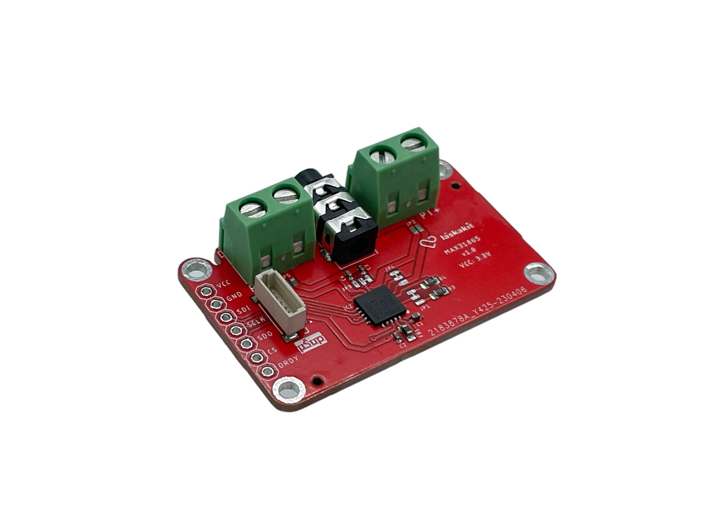

# LaskaKit MAX31865 converter for PT100 and PT1000

Converter module for PT100 and PT1000 platinum resistance temperature sensors (RTD) with SPI interface. Thanks to the MAX31865 chip, it achieves high accuracy with both four-wire and three-wire sensors. The converter also supports two-wire sensors, but their accuracy is lower than with multi-wire sensors, because the lead resistance adds to the measurement.

- Chip: MAX31865, 15-bit ADC
- Resolution: 0.03125 °C
- Accuracy: ±0.5 °C (0.05 % of full scale)
- 0.1 % reference resistors: R3 = 430 Ω (PT100), R4 = 4.3 kΩ (PT1000)
- Interface: SPI (pin header + µŠup connector)
- **Power and logic: 3.3 V.** The module has no regulator and no logic level translator. Do not connect it to 5 V.

The module ships configured for **PT100 and a 4-wire sensor**.

## Pins

| Pin | Function |
|---|---|
| VCC | 3.3 V supply |
| GND | ground |
| SDI | SPI MOSI |
| CLK | SPI SCK |
| SDO | SPI MISO |
| CS | SPI chip select |
| DRDY | data ready (optional) |

## Which version do I have?

- **v2.0** – the jumper setup table and "v2.0" are printed on the bottom side of the board.
- **v1.0 / v1.1** – the version is printed on the top side next to the logo, the bottom side has no table.

Jumper positions (top, bottom, right, left) refer to the top side of the board with the terminal blocks facing up.

Jumpers JP1, JP3 and JP4 have one side connected by a thin trace from the factory. Before soldering the other side, cut this trace (e.g. with a sharp knife) and check with a multimeter that it is open.

## Setup – version 2.0

### Sensor type (JP1 + JP3, always both the same)

| Sensor | JP1 | JP3 |
|---|---|---|
| PT100 (default) | right | right |
| PT1000 | left | left |

### Number of wires (JP2, JP4, JP5)

| Sensor | JP2 | JP4 | JP5 |
|---|---|---|---|
| 4-wire (default) | open | top | open |
| 3-wire | open | bottom | closed |
| 2-wire | closed | top | closed |

## Setup – version 1.0 and 1.1

### Sensor type (JP1 + JP3, always both)

| Sensor | JP1 | JP3 |
|---|---|---|
| PT100 (default) | top | right |
| PT1000 | bottom | left |

### Number of wires (JP2, JP4, JP5)

Same as version 2.0:

| Sensor | JP2 | JP4 | JP5 |
|---|---|---|---|
| 4-wire (default) | open | top | open |
| 3-wire | open | bottom | closed |
| 2-wire | closed | top | closed |

## Sensor wiring

Wires connected to the same end of the sensor usually have the same color. Check them with a multimeter – between them you measure only the lead resistance (approx. 0–2 Ω), between the pairs the sensor resistance (approx. 100 Ω for PT100, 1000 Ω for PT1000).

- **4-wire:** one pair to the PT+ terminal block, the other pair to PT−. The order within a pair and the side do not matter.
- **3-wire:** the two same-color wires to PT+, the third wire to PT− (either of its two terminals).
- **2-wire:** one wire to PT+, the other to PT−. The 3.5 mm jack can also be used, it is intended **for 2-wire sensors only**.

## Software

The module is compatible with the [Adafruit MAX31865](https://github.com/adafruit/Adafruit_MAX31865) library. An example is in the [SW](https://github.com/LaskaKit/MAX31865_PT100x/tree/main/SW/max31865) folder.

Set the values in the code according to the sensor and jumper setup:

```cpp
// PT100:  RREF 430.0,  RNOMINAL 100.0
// PT1000: RREF 4300.0, RNOMINAL 1000.0
#define RREF      430.0
#define RNOMINAL  100.0

thermo.begin(MAX31865_4WIRE);  // MAX31865_2WIRE, MAX31865_3WIRE or MAX31865_4WIRE
```

If RREF in the code does not match the JP1 setting, the measured temperature will be completely wrong.

## Version history

See [Version.md](Version.md).

## The module is available at https://www.laskakit.cz/laskakit-max31865-prevodnik-pro-termoclanek-pt100-1000/
