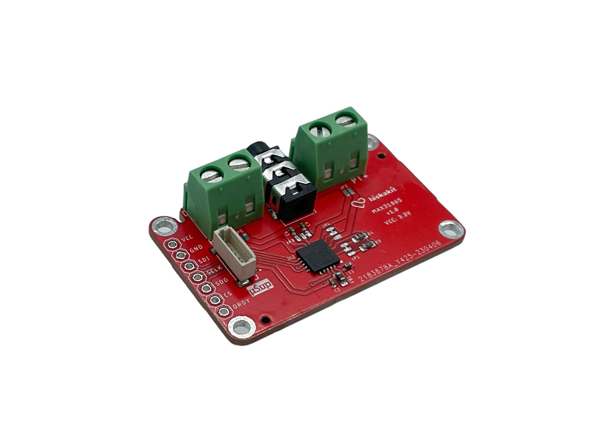

# LaskaKit MAX31865 převodník pro odporová čidla PT100 a PT1000

Modul převodníku pro platinová odporová teplotní čidla (RTD) PT100 a PT1000 s rozhraním SPI. Díky čipu MAX31865 dosahuje vysoké přesnosti měření u čtyřvodičových i třívodičových čidel. Převodník podporuje i dvouvodičová čidla, u nich však nelze očekávat takovou přesnost jako u vícevodičových čidel, protože do měření vstupuje odpor přívodních vodičů.

- Čip: MAX31865, 15bitový ADC
- Rozlišení: 0,03125 °C
- Přesnost: ±0,5 °C (0,05 % plného rozsahu)
- Referenční rezistory 0,1 %: R3 = 430 Ω (PT100), R4 = 4,3 kΩ (PT1000)
- Rozhraní: SPI (pinová lišta + µŠup konektor)
- **Napájení i logika: 3,3 V.** Modul nemá regulátor ani převodník logických úrovní. Nepřipojujte ho na 5 V.

Modul je z výroby nastaven pro **PT100 a čtyřvodičové čidlo**.

## Piny

| Pin | Funkce |
|---|---|
| VCC | napájení 3,3 V |
| GND | zem |
| SDI | SPI MOSI |
| CLK | SPI SCK |
| SDO | SPI MISO |
| CS | SPI chip select |
| DRDY | data ready (volitelné) |

## Jakou mám verzi?

- **v2.0** – na spodní straně desky je natištěná tabulka nastavení jumperů a nápis „v2.0“.
- **v1.0 / v1.1** – verze je natištěná na horní straně u loga, spodní strana tabulku nemá.

Polohy jumperů (nahoře, dole, vpravo, vlevo) platí při pohledu na horní stranu desky, svorkovnicemi nahoru.

Jumpery JP1, JP3 a JP4 mají z výroby propojenou jednu stranu tenkou cestou. Před přepájením na druhou stranu je nutné tuto cestu přeříznout (např. ostrým nožem) a zkontrolovat multimetrem, že je spoj rozpojený.

## Nastavení – verze 2.0

### Typ čidla (JP1 + JP3, vždy oba stejně)

| Čidlo | JP1 | JP3 |
|---|---|---|
| PT100 (výchozí) | vpravo | vpravo |
| PT1000 | vlevo | vlevo |

### Počet vodičů (JP2, JP4, JP5)

| Čidlo | JP2 | JP4 | JP5 |
|---|---|---|---|
| 4 vodiče (výchozí) | rozpojený | nahoře | rozpojený |
| 3 vodiče | rozpojený | dole | propojený |
| 2 vodiče | propojený | nahoře | propojený |

## Nastavení – verze 1.0 a 1.1

### Typ čidla (JP1 + JP3, vždy oba)

| Čidlo | JP1 | JP3 |
|---|---|---|
| PT100 (výchozí) | nahoře | vpravo |
| PT1000 | dole | vlevo |

### Počet vodičů (JP2, JP4, JP5)

Stejné jako u verze 2.0:

| Čidlo | JP2 | JP4 | JP5 |
|---|---|---|---|
| 4 vodiče (výchozí) | rozpojený | nahoře | rozpojený |
| 3 vodiče | rozpojený | dole | propojený |
| 2 vodiče | propojený | nahoře | propojený |

## Zapojení čidla

Vodiče, které jsou spojené na stejném konci čidla, mají většinou stejnou barvu. Ověřte je multimetrem – mezi nimi naměříte jen odpor vodičů (cca 0–2 Ω), mezi páry odpor čidla (cca 100 Ω u PT100, 1000 Ω u PT1000).

- **4 vodiče:** jeden pár do svorkovnice PT+, druhý pár do PT−. Pořadí v rámci páru ani strana nehraje roli.
- **3 vodiče:** dva vodiče stejné barvy do PT+, třetí vodič do PT− (do kterékoliv z jejích dvou svorek).
- **2 vodiče:** jeden vodič do PT+, druhý do PT−. Lze použít také 3,5mm jack, který je určen **pouze pro dvouvodičová čidla**.

## Software

Modul je kompatibilní s knihovnou [Adafruit MAX31865](https://github.com/adafruit/Adafruit_MAX31865). Příklad je ve složce [SW](https://github.com/LaskaKit/MAX31865_PT100x/tree/main/SW/max31865).

V kódu nastavte hodnoty podle čidla a zapojení jumperů:

```cpp
// PT100:  RREF 430.0,  RNOMINAL 100.0
// PT1000: RREF 4300.0, RNOMINAL 1000.0
#define RREF      430.0
#define RNOMINAL  100.0

thermo.begin(MAX31865_4WIRE);  // MAX31865_2WIRE, MAX31865_3WIRE nebo MAX31865_4WIRE
```

Pokud hodnota RREF v kódu neodpovídá nastavení JP1, bude naměřená teplota zcela chybná.

## Historie verzí

Viz [Version.md](Version.md).

## Modul je dostupný na https://www.laskakit.cz/laskakit-max31865-prevodnik-pro-termoclanek-pt100-1000/
